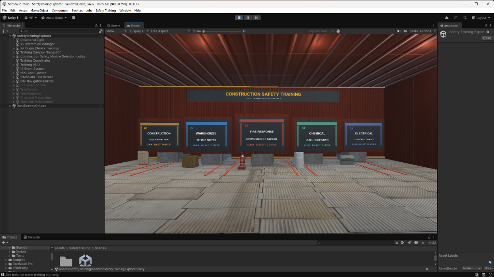
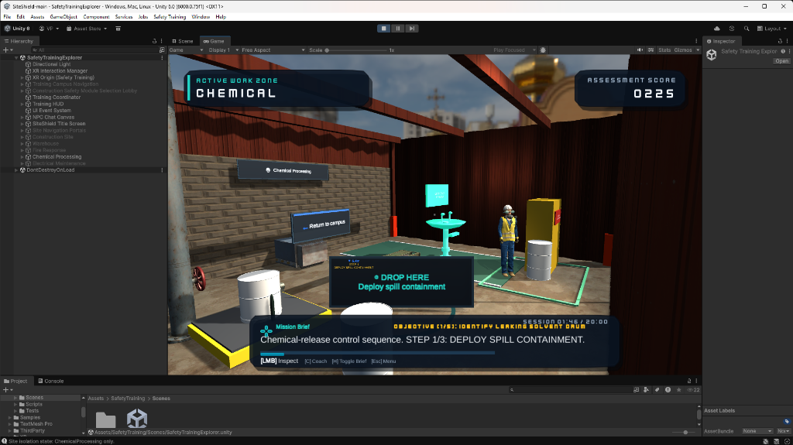
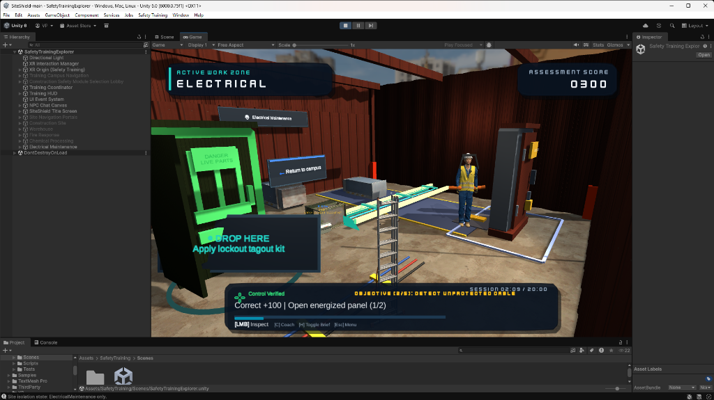
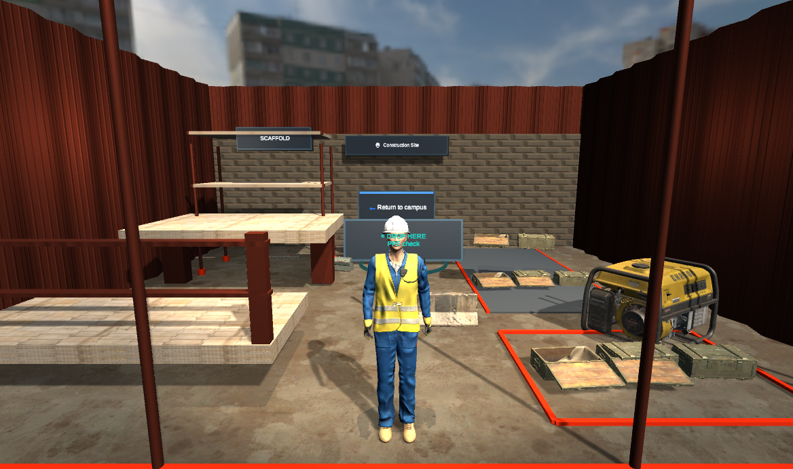
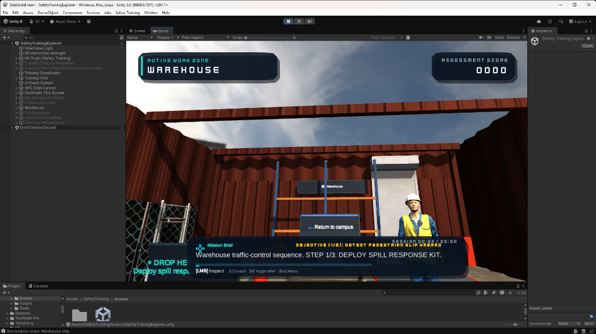
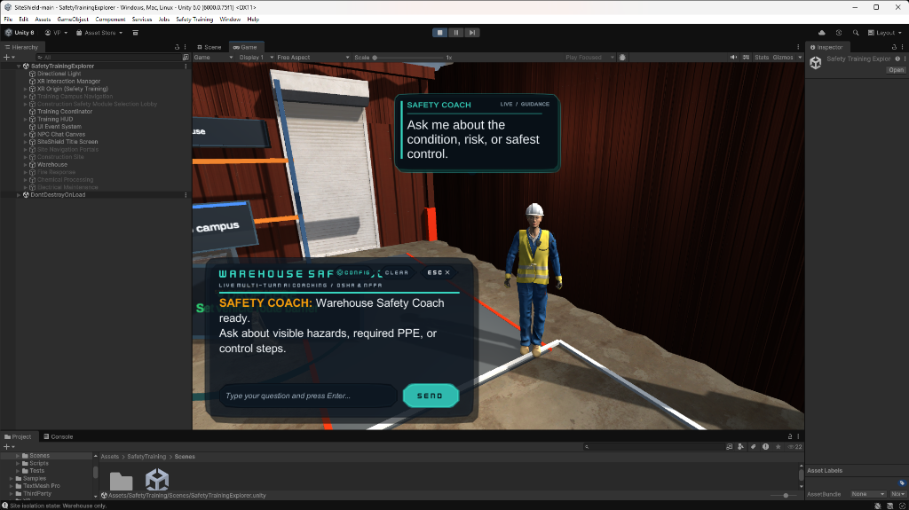
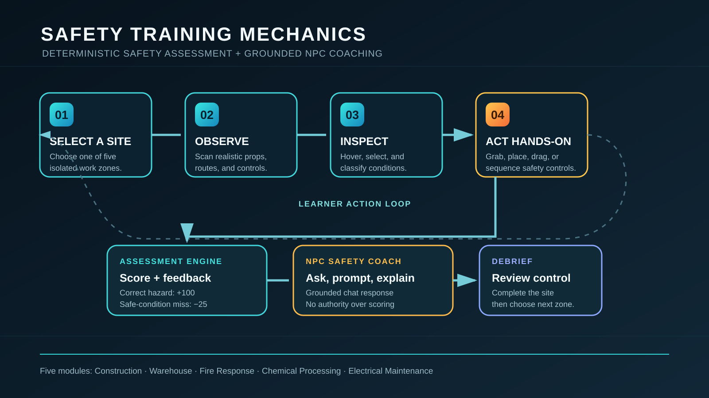

# SiteShield — Industrial Workplace Safety Training Simulator

[](https://unity.com/)
[](https://www.khronos.org/openxr/)
[](Assets/SafetyTraining/Tests/EditMode)
[](https://docs.microsoft.com/en-us/dotnet/csharp/)
[](Assets/SafetyTraining/Scripts/Runtime/SafetyAiClient.cs)

**SiteShield** is an immersive industrial workplace safety simulator built in **Unity 6**. It bridges the critical divide between theoretical classroom safety training and real-world hazard recognition by allowing learners, apprentices, and safety personnel to practice risk assessment and OSHA/NFPA-aligned procedural controls in a fully interactive, risk-free 3D environment.

Designed for cross-platform deployment, SiteShield provides **native OpenXR virtual reality tracking** alongside a complete **desktop first-person keyboard and mouse exploration mode**.

---

## Table of Contents

- [Visual Tour & Screenshots](#visual-tour--screenshots)
- [System Architecture & Training Mechanics](#system-architecture--training-mechanics)
- [Key Features](#key-features)
- [The Five Training Modules](#the-five-training-modules)
  - [1. Construction Safety — Fall Protection](#1-construction-safety--fall-protection)
  - [2. Warehouse Safety — Vehicle Routes](#2-warehouse-safety--vehicle-routes)
  - [3. Fire Response — Extinguisher & Egress](#3-fire-response--extinguisher--egress)
  - [4. Chemical Safety — Labeling & Segregation](#4-chemical-safety--labeling--segregation)
  - [5. Electrical Safety — Lockout/Tagout (LOTO)](#5-electrical-safety--lockouttagout-loto)
- [Interactive AI Safety Coach](#interactive-ai-safety-coach)
- [Controls](#controls)
- [Technology Stack](#technology-stack)
- [Project Structure](#project-structure)
- [Installation & Setup](#installation--setup)
- [Testing & Validation](#testing--validation)
- [Roadmap & Planned Features](#roadmap--planned-features)
- [Third-Party Credits & Attribution](#third-party-credits--attribution)
- [License](#license)

---

## Visual Tour & Screenshots

### Training Campus Hub
The continuous central hub connects all five industrial training sites through dedicated portals, tactile route lanes, and interactive equipment pedestals.


### Active Work Zones & Hands-On Scenarios

| Chemical Processing & Spill Containment | Electrical Maintenance & Lockout/Tagout |
| :---: | :---: |
|  |  |
| *Identifying solvent drum leaks, eyewash stations, and deploying secondary containment.* | *Lockout/Tagout (LOTO) padlocking, switchgear isolation, and cable crossing protection.* |

| Construction Site & Fall Protection | Warehouse Traffic & Egress Safety |
| :---: | :---: |
|  |  |
| *Scaffold structural integrity, perimeter barricading, and guardrail installation.* | *Blind-corner traffic control, pedestrian pathways, and quick-response spill kits.* |

### Conversational Safety Coach & In-Game HUD
Learners can open dialogue with the nearest Microsoft Rocketbox NPC companion to ask clarifying questions about regulations, hazards, and correct mitigation steps.


---

## System Architecture & Training Mechanics

SiteShield decouples pedagogical evaluation from language model generation. The **deterministic assessment engine** retains absolute authority over task progress, hazard validation, and scoring, ensuring objective certification criteria cannot be bypassed or distorted by AI hallucination.

```
+-----------------------------------------------------------------------------------+
|                              SITESHIELD ARCHITECTURE                             |
+-----------------------------------------------------------------------------------+
|                                                                                   |
|  +--------------------+        +-------------------------+        +------------+  |
|  |  Player Input      | -----> |  DesktopExplorer / XR   | -----> | Training   |  |
|  |  (WASD / Mouse /   |        |  Pointer Gate           |        | Controller |  |
|  |   OpenXR Touch)    |        +-------------------------+        +-----+------+  |
|  +--------------------+                                                 |         |
|                                                                         v         |
|  +----------------------------------------------------------------------------+  |
|  |                     DETERMINISTIC ASSESSMENT ENGINE                        |  |
|  |  * Real Hazard Detection (+100 pts)    * False Positive Penalty (-25 pts)  |  |
|  |  * Sequential Practical Hands-On Drop Targets (+20 pts bonus)              |  |
|  |  * Real-Time Score Delta Feedback      * ISO 3864 Safety Color System      |  |
|  +-------------------------------------+--------------------------------------+  |
|                                        |                                          |
|                                        v                                          |
|  +----------------------------------------------------------------------------+  |
|  |                        GROUNDED AI COACHING LAYER                          |  |
|  |  * SafetyAiContextBuilder (OSHA 1926/1910 & NFPA 70E context injection)    |  |
|  |  * Local Ollama (hermes3:8b) / OpenAI REST Endpoint                        |  |
|  |  * ScriptedConversationService (Deterministic Offline Fallback)            |  |
|  +----------------------------------------------------------------------------+  |
|                                                                                   |
+-----------------------------------------------------------------------------------+
```



- **Unbiased Discovery**: In accordance with field-ops training standards, hazards and controlled look-alikes are visually uncolored prior to inspection.
- **Scoring Mechanics**:
  - **+100 Points**: Correct identification and verification of an active hazard.
  - **-25 Points**: False-positive penalty for misidentifying a safe/controlled condition.
  - **Sequential Bonus**: Completing hands-on equipment placement sequences in the prescribed order awards bonus completion points.
- **Dynamic Site Isolation**: The `SiteIsolationController` optimizes GPU fill-rate by selectively activating rendering and physics solely for the current workplace zone.

---

## Key Features

- **Five Industrial Training Environments**: Authentically staged construction, logistics warehouse, fire protection, chemical processing, and electrical substations.
- **Dual Input Architecture**: Full desktop first-person navigation (unrestricted yaw, clamped pitch `[-80°, +80°]`, natural mouse look, cursor locking) alongside comprehensive OpenXR headset and controller tracking.
- **Hands-On Sequence Controller**: Multi-step physical drag-and-drop workflows (e.g., retrieving PPE kits, deploying spill response gear, affixing lockout padlocks).
- **Procedural Audio Synthesizer**: Zero external audio asset dependencies; UI clicks, spatial success chimes, alert buzzers, and environmental portal sweeps are generated entirely at runtime via algorithmic C# audio synthesis.
- **Role-Aware AI Safety Coach**: Multi-turn in-game chat interface grounded in authored site facts and regulatory guidelines, featuring automatic fallback to deterministic scripted coaching when offline.
- **100% Automated Unit Test Coverage**: 114 passing EditMode tests validating scoring matrices, sequence controllers, input gates, audio synthesizers, theme tokens, and camera controllers.

---

## The Five Training Modules

### 1. Construction Safety — Fall Protection
- **Focus**: Working at height, structural scaffold safety, and perimeter demarcation (OSHA 1926 Subpart L & M).
- **Interactive Scenarios**:
  - Identifying unpinned scaffold uprights and missing toe-boards.
  - Inspecting ladder rungs and structural cross-bracing.
  - Deploying perimeter exclusion barricades and warning tape.
  - Assembling modular guardrail kits and staging material carts.
- **Learning Outcome**: Understand the critical sequence of securing fall arrest systems and perimeter barricades before commencing work aloft.

### 2. Warehouse Safety — Vehicle Routes
- **Focus**: Material handling, pedestrian segregation, and slip/trip prevention (OSHA 1910 Subpart D & N).
- **Interactive Scenarios**:
  - Inspecting blind intersections and obstructed high-traffic forklift transit lanes.
  - Detecting pallet staging overhangs and leaking fluid slip hazards.
  - Deploying rapid-action absorbent spill kits to contain pedestrian slip risks.
  - Verifying unblocked exit aisles and floor tape integrity.
- **Learning Outcome**: Master industrial traffic management rules and rapid hazard containment in fast-paced logistics hubs.

### 3. Fire Response — Extinguisher & Egress
- **Focus**: Initial fire defense, emergency egress corridors, and alarm notification (OSHA 1910 Subpart E & L / NFPA 10).
- **Interactive Scenarios**:
  - Assessing Class ABC dry chemical extinguisher charge gauges and inspection tags.
  - Clearing obstructed manual pull stations and emergency illuminated exit doors.
  - Applying the **P.A.S.S.** operational framework (Pull, Aim, Squeeze, Sweep).
- **Learning Outcome**: Develop rapid decision-making regarding when to fight an incipient fire versus executing safe evacuation protocol.

### 4. Chemical Safety — Labeling & Segregation
- **Focus**: Hazardous material containment, GHS pictograms, and emergency wash accessibility (OSHA 1910.1200 HazCom & 1910.151).
- **Interactive Scenarios**:
  - Inspecting solvent drum bungs, GHS hazard warning labels, and grounding clamps.
  - Segregating incompatible chemical containers.
  - Testing emergency eyewash and drench shower clearance.
  - Positioning secondary spill berms and containment pallets.
- **Learning Outcome**: Recognize hazardous chemical labeling, incompatible storage dangers, and primary emergency mitigation steps.

### 5. Electrical Safety — Lockout/Tagout (LOTO)
- **Focus**: Control of hazardous energy and arc-flash boundaries (OSHA 1910.147 & NFPA 70E).
- **Interactive Scenarios**:
  - Inspecting energized main distribution switchgear and open live electrical panels.
  - Affixing safety hasps, red danger tags, and lockout padlocks to circuit breakers.
  - Verifying zero-energy state before approaching conductors.
  - Securing heavy industrial cable ramps across pedestrian walkways.
- **Learning Outcome**: Execute the mandatory six-step lockout/tagout protocol to guarantee mechanical and electrical isolation.

---

## Interactive AI Safety Coach

Each module features a dedicated Microsoft Rocketbox NPC safety companion capable of answering trainee inquiries in natural language.

```
Learner: "Why can't I just step over this cable on the floor?"
Coach:   "Unprotected high-voltage cables pose both severe trip hazards and insulation
          wear risks from foot traffic. You must install a rated cable ramp or reroute
          the line overhead before continuing."
```

### LLM Architecture & Safety Guardrails
- **Configurable Backend**: Powered by `SafetyAiClient`, connecting to any OpenAI-compatible REST API (local Ollama instances, LM Studio, or cloud endpoints).
- **Strict Role-Grounding**: `SafetyAiContextBuilder` injects authoritative workplace rules and active scenario facts into every prompt.
- **Deterministic Offline Fallback**: If the local model or API is unreachable, `ScriptedConversationService` automatically engages, supplying tailored, contextual guidance without dropping game state.
- **Zero Hallucination Scoring**: The AI coach cannot alter task state or add/deduct points; scoring is evaluated solely by C# rule contracts.

---

## Controls

SiteShield automatically detects whether an OpenXR VR headset is initialized. If no VR hardware is active, desktop controls are engaged automatically.

### Desktop Keyboard & Mouse

| Input Action | Desktop Binding | Functionality |
| :--- | :--- | :--- |
| **Move** | `W` / `A` / `S` / `D` | Planar locomotion relative to camera orientation |
| **Look** | Mouse Movement | First-person look (yaw rotates body; pitch clamped at `±80°`) |
| **Inspect / Select** | `Left Mouse Button` (LMB) | Inspect hazard at center reticle; click UI / portal |
| **Drag & Place** | `LMB (Hold & Drag)` | Pick up and place hands-on equipment into drop zones |
| **AI Coach Dialogue** | `C` | Open / close the interactive chat modal with nearest NPC |
| **Toggle Mission Brief** | `H` | Show / hide the HUD objective panel |
| **Toggle Cursor / Menu** | `Escape` | Unlock mouse cursor / open Title Screen settings |

### OpenXR Virtual Reality

| Input Action | VR Controller Binding | Functionality |
| :--- | :--- | :--- |
| **Locomotion** | Primary Thumbstick | Smooth planar ground locomotion |
| **Snap / Smooth Turn** | Secondary Thumbstick | Step snap turn or smooth view rotation |
| **Raycast Selection** | Trigger / Grip | Select interactables, examine hazards, enter portals |
| **Object Manipulation** | Controller Grip (Hold) | Pick up PPE, fire extinguishers, and lockout kits |
| **UI Interaction** | Direct / Ray Pointer | Tap floating menu panels and virtual keyboard |

---

## Technology Stack

- **Game Engine**: Unity 6 (`6000.0.75f1`)
- **Programming Language**: C# (.NET Standard 2.1)
- **XR Runtime**: Unity OpenXR Plugin (`com.unity.xr.openxr` v1.16.1)
- **Interaction Framework**: Unity XR Interaction Toolkit (`com.unity.xr.interaction.toolkit` v3.4.1)
- **Input System**: Unity Input System (`com.unity.inputsystem` v1.19.0) with Dual-Input compatibility
- **UI Framework**: Unity uGUI & TextMeshPro (`com.unity.ugui` v2.0.0)
- **Rendering Pipeline**: Universal Render Pipeline (URP) / Built-in with Shader Graph (`com.unity.shadergraph` v17.0.4)
- **Serialization**: Newtonsoft Json.NET (`com.unity.nuget.newtonsoft-json` v3.2.2)
- **Quality Assurance**: Unity Test Framework (`com.unity.test-framework` v1.6.0)

---

## Project Structure

```
SiteShield/
├── Assets/
│   ├── SafetyTraining/
│   │   ├── Editor/                    # Scene builders, prop dressers, automation utilities
│   │   ├── Generated/                 # Procedurally generated equipment and isolation meshes
│   │   ├── GeneratedMaterials/        # Curated ISO 3864 compliant PBR materials
│   │   ├── Scenes/
│   │   │   └── SafetyTrainingExplorer.unity   # Primary comprehensive training scene
│   │   ├── Scripts/
│   │   │   ├── Core/                  # Task, session, and scoring data models
│   │   │   └── Runtime/               # Locomotion, HUD, AI coach, audio, and portal logic
│   │   └── Tests/
│   │       └── EditMode/              # Automated unit tests (114 passing tests)
│   ├── ThirdParty/
│   │   ├── Kenney/                    # CC0 Sci-Fi UI design elements
│   │   ├── MicrosoftRocketbox/        # Rigged industrial character avatar models
│   │   ├── PolyHaven/                 # CC0 high-fidelity industrial props & PBR textures
│   │   └── UnityPeopleSansPeople/     # Rigged animation rigs
│   └── XR/
│       └── Settings/                  # OpenXR and XR Interaction Toolkit presets
├── docs/
│   └── images/                        # High-resolution documentation captures & diagrams
└── README.md
```

---

## Installation & Setup

### Prerequisites
1. **Unity Hub**: Installed on your workstation.
2. **Unity Editor**: Version **`6000.0.75f1` (Unity 6)** or later.
3. **VR Hardware (Optional)**: Meta Quest 2/3/Pro (via Quest Link), Valve Index, HTC Vive, or any OpenXR-compatible headset. *(Desktop mode requires no VR hardware).*

### Step-by-Step Setup
1. **Clone the Repository**:
   ```bash
   git clone https://github.com/vishalgangwar176/SiteShield.git
   cd SiteShield
   ```
2. **Open in Unity Hub**:
   - Launch Unity Hub.
   - Click **Add** > **Add project from disk**.
   - Select the `SiteShield` root folder.
   - Ensure the Editor Version is set to `6000.0.75f1`.
3. **Load the Primary Scene**:
   - In the Unity Project window, navigate to:
     `Assets/SafetyTraining/Scenes/SafetyTrainingExplorer.unity`
   - Double-click to open the scene.
4. **Enter Play Mode**:
   - Click the **Play** button at the top of the Unity Editor.
   - Use `WASD` to move and your mouse to look around. Left-click anywhere in the game viewport to capture the cursor and begin practicing.

---

## AI Safety Coach Setup

The AI Safety Coach connects to an OpenAI-compatible endpoint.

### Option A: Local Ollama (Default & Zero-Cost)
1. Install [Ollama](https://ollama.ai/).
2. Pull the default model:
   ```bash
   ollama run hermes3:8b
   ```
3. Ollama exposes `http://localhost:11434/v1/chat/completions` by default. SiteShield is pre-configured to communicate with this endpoint automatically.

### Option B: Hosted OpenAI / Custom Provider
1. Open the inspector for the `LlmEndpointConfig` asset at `Assets/SafetyTraining/Runtime/`:
   - Set **Endpoint**: `https://api.openai.com/v1/chat/completions`
   - Set **Model**: `gpt-4o-mini` (or your preferred model)
   - Set **API Key Environment Variable**: Enter the name of your environment variable (e.g., `OPENAI_API_KEY`).
2. Set the environment variable on your operating system:
   ```powershell
   # Windows PowerShell
   [System.Environment]::SetEnvironmentVariable('OPENAI_API_KEY', 'your-key-here', 'User')
   ```
> **Security Notice**: Never hardcode API keys directly into Unity scenes, ScriptableObjects, or source files. SiteShield only reads keys dynamically from environment variables at runtime.

### Option C: Complete Offline Mode
If no API endpoint is available or configured, SiteShield automatically routes all coach interactions through `ScriptedConversationService`, delivering instant, deterministic responses with zero latency and zero internet required.

---

## Testing & Validation

SiteShield maintains automated unit test coverage across all core systems.

### Running Tests in Unity Editor
1. Open Unity and select **Window** > **General** > **Test Runner**.
2. Select the **EditMode** tab.
3. Click **Run All** to execute the test suite.

### Running Headless Batchmode Tests
From PowerShell or terminal:
```powershell
& "C:\Program Files\Unity\Hub\Editor\6000.0.75f1\Editor\Unity.exe" `
  -batchmode -nographics `
  -projectPath . `
  -runTests -testPlatform editmode `
  -testResults test-results.xml `
  -logFile -
```
*Current test suite result: **114 Passed, 0 Failed, 0 Skipped (100% Pass Rate)**.*

---

## Roadmap & Planned Features

- [x] Continuous 5-zone industrial training campus.
- [x] Deterministic scoring and hazard evaluation engine.
- [x] Dual-input support (OpenXR VR + First-Person Desktop).
- [x] Hands-on multi-step drop-and-place interactables.
- [x] Procedural synthetic runtime audio manager.
- [x] Multi-turn role-aware AI Safety Coach with offline fallback.
- [ ] Multi-user collaborative training sessions via Netcode for GameObjects.
- [ ] Enterprise LMS integration (SCORM / xAPI export for compliance logging).
- [ ] Heatmap analytics tracking learner gaze and inspection dwell times.

---

## Third-Party Credits & Attribution

- **Microsoft Rocketbox Avatar Library**: Rigged adult worker avatars licensed under the MIT License. Reference: Gonzalez-Franco et al. (2020), *The Rocketbox library and the utility of freely available rigged avatars*.
- **Poly Haven**: CC0 3D industrial environment props and PBR textures (`Assets/ThirdParty/PolyHaven/`).
- **Kenney.nl**: CC0 Sci-Fi UI vector icons and fonts (`Assets/ThirdParty/Kenney/`).
- **Unity Technologies**: OpenXR Plugin, XR Interaction Toolkit, and Input System packages.

---

## License

This project's source code and custom safety training systems are maintained under the repository owner's copyright. Third-party character models, meshes, and UI icons retain their respective MIT and CC0 open licenses as documented in their subdirectories.

*To specify an explicit open-source license (such as MIT or Apache 2.0) for this repository, add a `LICENSE` file to the root directory.*

